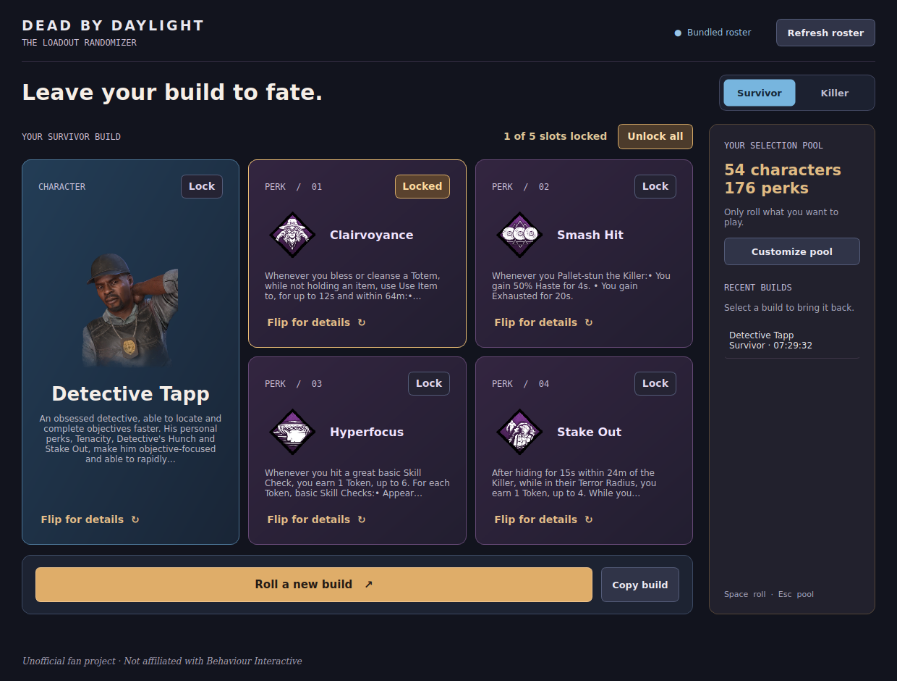

# Dead by Daylight Randomizer

An offline-ready Python/PyQt6 desktop app for randomizing Survivor and Killer builds, with optional items and add-ons.



## Features

- **Both roles:** randomly select a character and four distinct, role-appropriate perks.
- **Optional equipment:** enable **Include items and add-ons** for a Survivor item with up to two distinct compatible add-ons, or up to two power-specific Killer add-ons. Leave it off for the original character-and-perks-only mode (the default).
- **Your selection pool:** search, include, or exclude characters, perks, items, and add-ons; click anywhere on a row to toggle it, or select/clear all entries in the active tab (including filtered-out entries). Separate pools are remembered for Survivor and Killer.
- **Slot locks:** keep the character or any perk while rerolling the rest. Locked perks are never duplicated.
- **Build history:** restore any of the last 20 rolls, with a local-time timestamp on each entry and the full date/time in its tooltip.
- **Copy and inspect:** copy a readable build including equipment, or flip each card to its scrollable full description without opening another window.
- **Offline first:** a bundled roster makes the first launch work without a network connection. Refresh the roster explicitly when you want new data.
- **Resilient updates:** downloads run in the background and are validated before replacing the local cache.

Offerings, inventory/account integration, and build-strength recommendations are not included.

## Install and run

Requires **Python 3.10+**

### Python

```sh
python -m venv .venv
```

Activate the environment:

```sh
# Linux / macOS (use python3 above if needed)
source .venv/bin/activate

# Windows PowerShell
.venv\Scripts\Activate.ps1
```

Then install and launch:

```sh
python -m pip install -e .
dbd-randomizer
```

The original launcher remains available:

```sh
python main.py
```

You can also use `python -m dbd_randomizer.app`.

## Using the app

1. Choose **Survivor** or **Killer**. An initial build is generated automatically.
2. Open **Customize pool** and uncheck anything you do not own or want to use. Keep at least one character and four perks. **Save** applies the pool to future rolls; **Cancel** discards edits.
3. Leave **Include items and add-ons** unchecked for just the character and perks, or check it to generate a build with equipment. Survivor add-ons match the rolled item's type; Killer add-ons match the selected Killer's power. Each perk and each add-on is unique within its group.
4. Click **Lock** on a character/perk slot you want to keep. **Unlock all** releases those locks. Equipment always rerolls; locking the Killer keeps its add-ons tied to that Killer. If all five character/perk slots are locked, rolling is disabled only when equipment is off.
5. Use **Copy build** to share the entire build. Click a recent build to restore it, including its equipment mode, without changing your pool.
6. Use **Refresh roster** to download the current API data. You can keep rolling during a refresh; pool editing is temporarily disabled.

### Keyboard shortcuts

| Action | Shortcut |
| --- | --- |
| Roll unlocked slots | `Space` |
| Open selection pool / cancel pool edits | `Escape` |
| Copy build | `Ctrl+Shift+C` |
| Navigate controls | `Tab` / `Shift+Tab` |

In the pool editor, Space types a space in search or toggles the focused row; it never rolls a build. Select all / Clear all applies to the active tab, including hidden search results.

Use **Flip for details** and **Back to build** to switch card faces. Locks remain available on either side; a changed entry returns to its front face.

Holiday and other limited-time event items (including anniversary variants) are **excluded by default**. They remain available under **Customize pool → Items**, labelled **Event item**, so you can explicitly select any you own. Opt-ins are remembered across restarts and roster refreshes; newly added event items stay off until selected. Older saved pools adopt this default without resetting other exclusions.

Equipment pools include inventory items, but exclude quest/perk-created items and retired add-ons. Unscoped, event-only Killer add-ons such as Blight Serum are excluded. Use **Customize pool** to exclude items you don't own. Items without add-ons, such as firecrackers, show empty add-on slots. If your exclusions leave fewer than two compatible add-ons, only the remaining ones are rolled; excluding every item prevents equipment rolls until you select an item or turn equipment off. Item and add-on cards and selection-pool rows show cached game icons downloaded on demand, just like characters and perks. The artwork manifest covers all 38 selectable items and 922 add-ons. The Judgment's 20 add-on icons are not available in the pinned asset sources yet; those and newly added entries use the initials fallback on cards.

History and locks are session-only. Role, equipment mode, selection pools, and window geometry persist. Switching roles releases locks.

## Data, offline behavior, and privacy

Data comes from [Tricky's DBD API](https://dbd.tricky.lol/api/).

At startup the app uses, in order:

1. A valid locally refreshed `catalog.json`.
2. The bundled `dbd_randomizer/data/catalog.json` if there is no valid cache. Older caches without equipment data fall back to the bundle with a notice; refresh to replace them.

**Roster data is offline unless you explicitly refresh.** Missing artwork downloads automatically in the background when displayed, including at startup and when rolling or opening the pool editor. Cached artwork requires no network access. An explicit roster refresh makes four HTTPS requests (`characters`, `perks`, `items`, and `addons`), with socket timeouts, response-size limits, a cooperatively checked download time budget, and schema validation. Failed or cancelled refreshes never replace a valid cache. Closing during a refresh requests cancellation.

The cache lives in Qt's per-user application-data directory, not the project directory. Typical locations:

- Linux: `~/.local/share/DBDRandomizer/DBD Randomizer/catalog.json`
- Windows: `%LOCALAPPDATA%\DBDRandomizer\DBD Randomizer\catalog.json`
- macOS: `~/Library/Application Support/DBDRandomizer/DBD Randomizer/catalog.json`

Artwork lives separately in Qt's per-user cache directory (`CacheLocation`), under `artwork/`—on Linux, typically `~/.cache/DBDRandomizer/DBD Randomizer/artwork/`. It is not stored in the project or included in packages. Downloads use pinned GitHub raw-content URLs, with up to four concurrent requests, a 15-second transfer timeout, an 8 MiB response limit, image validation, and atomic cache writes. Missing or failed images show initials; failed downloads are retried next launch. Changing a pinned source revision selects a new cache key. Clearing the device cache causes artwork to be downloaded again as needed.

There is no telemetry or account access; roster refreshes contact the API host and artwork requests contact `raw.githubusercontent.com`.

### Structure

```text
main.py                         Compatibility launcher
pyproject.toml                  Package metadata and reproducible dependencies
dbd_randomizer/
  app.py                        Window, settings, refresh worker, entry point
  widgets.py                    Loadout cards and selection-pool dialog
  style.qss                     Desktop theme
  core.py                       GUI-independent catalog and roll logic
  data_service.py               Validated network refresh and atomic cache
  artwork.py                    Background artwork downloads and device-cache lookup
  data/catalog.json             Bundled offline roster
  data/artwork.json             Artwork mapping and pinned upstream source revision
tools/fetch_artwork.py          Optional device-cache warmer
tests/                          Core, data-service, and Qt workflow tests
```

### Updating the bundled roster for a DBD game update

Refresh only when needed; avoid repeatedly hitting the community API. From the project root, with the environment installed:

```sh
python -c "from pathlib import Path; from dbd_randomizer.data_service import DataService; snapshot = DataService(Path('dbd_randomizer/data')).refresh(); print(snapshot.fetched_at)"
```

### Artwork downloads

No artwork preparation is required to run or package the app. It downloads missing images as they are displayed and updates visible cards and pool icons when ready, without blocking the UI. Previously downloaded images work offline; uncached images use the initials fallback if the network is unavailable.

Optionally run `python tools/fetch_artwork.py` in the installed project environment to prefill the device cache for offline use. This does not write images into the repository.

## Credits

- Game names, character descriptions, and perk data belong to their respective owners. Dead by Daylight is a trademark of Behaviour Interactive. This is an unofficial fan project and is not affiliated with or endorsed by Behaviour Interactive.
- Thank you to [Tricky](https://dbd.tricky.lol/api/) for the data API.
- Downloaded game portraits and perk, item, and add-on icons sourced from [HexLegit/dbd-assets](https://github.com/HexLegit/dbd-assets), with a pinned revision in `data/artwork.json`. Game artwork belongs to Behaviour Interactive and the respective licensors.
- Legacy add-on icons absent from the main source are downloaded from [dearvoodoo/dbd](https://github.com/dearvoodoo/dbd), also the original prototype image source. These manifest entries pin their own source revision.
- The original application icon is credited to [Icons8](https://icons8.com/icon/gRPMIVdHQdZd/tally-mark-of-five).
